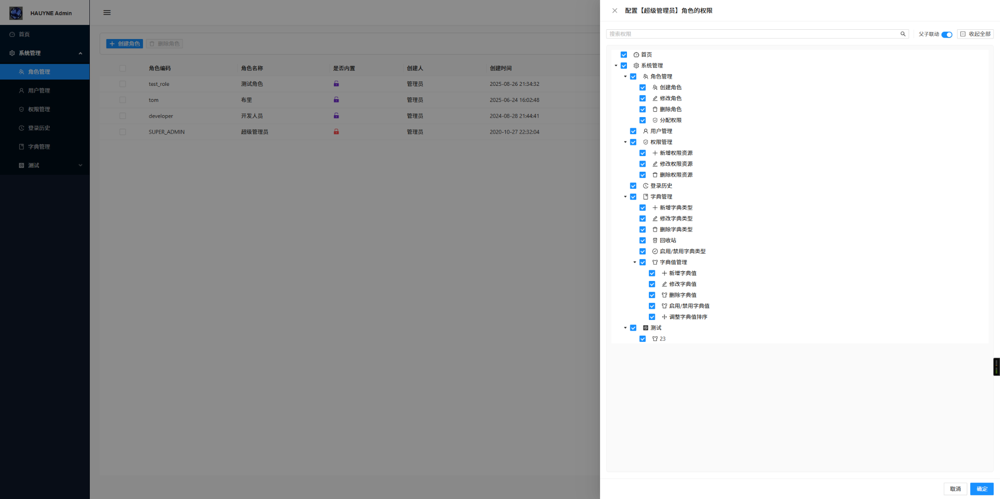
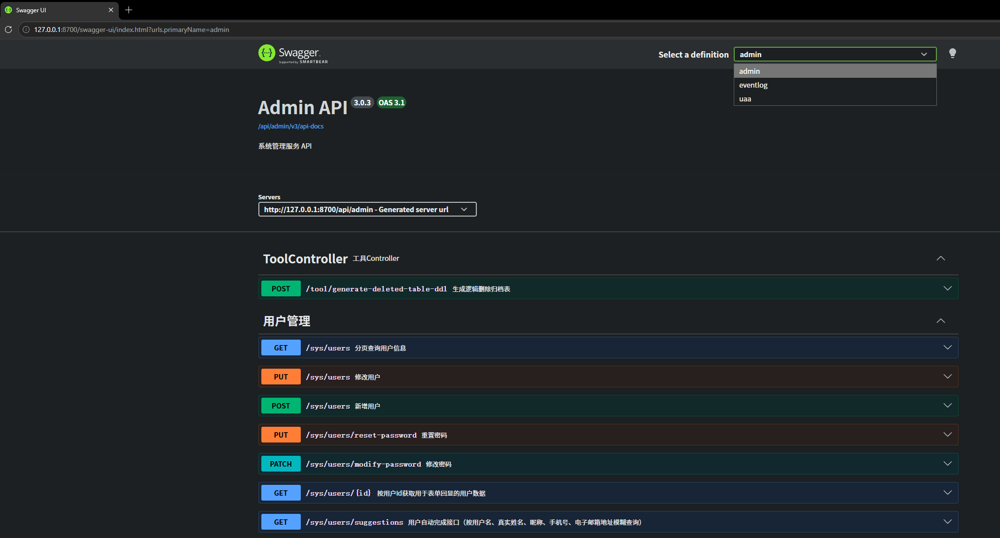

# Lapis

> **本项目原名 Hauyne，2026-10 起正式更名为 Lapis（青金石），中文名「青枢」。**
>
> 更名理由：Hauyne（蓝方石）与青金石同属方钠石族，本是同源的蓝色矿物，改名不是另起炉灶，
> 而是从"一块具体矿石"升级到"它所属的那一类宝石"；同时保留了原命名中
> "把矿石研磨成可用之物"的意象——本项目最核心的价值正是把通用能力（starter 封装、
> 枚举规范、认证链路）研磨成可被复用的组件。此外 Lapis 仅四个字母、无变音符号，
> 读写与口头沟通都不易出错，而 Hauyne 常被误拼为 haüyne / hauynite。
>
> 更名范围：Maven groupId、Java 包名、模块目录、Spring 应用名、数据库名、前端工程名。
> **数据表前缀 `hyn_` 保持不变**，存量库无需迁移表名。

Lapis 是一个基于 Spring Boot、Spring Cloud 和 Angular 的前后端分离后台管理项目。后端采用 Maven 多模块结构，提供统一认证、系统管理、权限控制、审计日志、网关、文件服务等能力；前端使用 Angular 与 NG-ZORRO 构建管理界面。

## 项目预览



*角色权限配置：支持以树形结构展示菜单和操作权限，并可进行父子联动勾选。*

## Swagger接口文档（Gateway网关聚合）


* 使用IP 127.0.0.1 访问 （访问localhost目前还存在 Servers的显示问题）*

## 主要技术

- **后端**：Java 17、Spring Boot 4、Spring Cloud、Spring Security、Spring Authorization Server
- **数据访问**：MyBatis-Plus、MySQL、Redis
- **微服务基础设施**：Eureka、Spring Cloud Config、Spring Cloud Gateway、OpenFeign
- **消息与审计**：RabbitMQ、JaVers
- **前端**：Angular、TypeScript、NG-ZORRO、NgRx
- **其他**：MinIO 文件服务、Springdoc OpenAPI

## 项目结构

```text
.
├── pom.xml                         # Maven 父工程
├── lapis-api-module/              # 微服务间共享的 API、DTO 和常量
├── lapis-starter-module/          # 通用 Starter 与基础能力
├── lapis-service-module/
│   ├── lapis-service-register/    # Eureka 注册中心
│   ├── lapis-service-config/      # 配置中心
│   ├── lapis-service-gateway/     # API 网关
│   ├── lapis-service-uaa/         # 认证与授权服务
│   ├── lapis-service-admin/       # 系统管理服务
│   ├── lapis-service-eventlog/    # 审计事件服务
│   ├── lapis-service-file/       # 文件服务
│   ├── lapis-monitor-server/      # 服务监控
│   └── ...                         # Redis、消息、工作流等公共模块
├── lapis-front-end/               # Angular 前端
└── SQL/
    ├── lapis_admin_dev.sql        # 管理服务数据库初始化脚本
    ├── lapis_uaa_dev.sql          # 认证服务数据库初始化脚本
    ├── lapis_eventlog_dev.sql     # 审计服务数据库初始化脚本
    └── flowable.sql                # Flowable 工作流相关脚本
```

## 本地部署与运行

以下步骤用于本地开发环境。请按顺序完成环境准备、数据库初始化、前端依赖安装和服务启动。

### 1. 安装运行环境

请先安装并启动以下软件：

- **JDK 17 或更高版本**
- **MySQL 8.x**
- **Redis**
- **RabbitMQ**
- **Node.js 24 或更高版本**（安装后可通过 `node -v` 和 `npm -v` 检查）

请确保相关服务正常运行，并且本机端口未被其他程序占用。后端使用 Maven 构建，项目根目录提供了父工程 `pom.xml`。

### 2. 配置本地服务账号

本项目当前开发配置使用以下连接信息，请将本地中间件配置为对应值，或按实际环境修改项目的开发配置文件。

| 服务 | 地址/端口 | 用户名 | 密码 |
|---|---|---|---|
| MySQL | `localhost:3306` | `root` | `123456` |
| Redis | `localhost:6379` | — | `123456` |
| RabbitMQ | `localhost:5672` | `guest` | `guest` |

> **注意：** RabbitMQ 默认的 `guest` 账号通常仅允许从本机连接。以上账号密码仅用于本地开发环境，请勿用于生产环境或暴露到公网。

### 2.1 通过环境变量覆盖配置（推荐）

2026-10 加固后，所有账号密码、密钥都已改为 `${环境变量:默认值}` 的占位形式。
上表中的值是**默认值**，本地不改任何东西也能跑起来；部署到其他环境时，**不要再改配置文件**，
而是通过环境变量注入，避免凭据进入 Git 仓库：

| 环境变量 | 对应配置 | 默认值 |
|---|---|---|
| `MYSQL_USERNAME` | `spring.datasource.username` | `root` |
| `MYSQL_PASSWORD` | `spring.datasource.password` | 上表默认值 |
| `REDIS_PASSWORD` | `spring.data.redis.password` | 上表默认值 |
| `RABBITMQ_USERNAME` / `RABBITMQ_PASSWORD` | `spring.rabbitmq.*` | `guest` / `guest` |
| `OAUTH2_CLIENT_SECRET` | 资源服务器自省用的 client-secret | 上表默认值 |
| `LOGIN_LOOKUP_SECRET` | `login.lookup.secret`（登录查询签名密钥） | 仓库中的默认值，**生产必须更换** |
| `MINIO_ACCESS_KEY` / `MINIO_SECRET_KEY` | 文件服务 MinIO 凭据 | 仓库中的默认值，**生产必须更换** |
| `COOKIE_SECURE` | 令牌 Cookie 是否仅 HTTPS 传输 | `false`，**HTTPS 环境必须设为 `true`** |
| `COOKIE_SAME_SITE` | 令牌 Cookie 的 SameSite 策略 | `Lax` |
| `CSRF_ENABLED` | 是否开启 CSRF 防护 | `false`，**生产建议设为 `true`** |
| `GATEWAY_INSECURE_TRUST_MANAGER` | 网关是否信任所有下游证书 | `false`，**任何时候都不应设为 `true`** |

IDEA 里可在 `Run/Debug Configurations → Environment variables` 中填写，例如：

```text
MYSQL_PASSWORD=你的密码;REDIS_PASSWORD=你的密码;COOKIE_SECURE=true;CSRF_ENABLED=true
```

### 3. 创建数据库并导入 SQL

在 MySQL 中创建以下三个数据库：

- `lapis_admin_dev`
- `lapis_uaa_dev`
- `lapis_eventlog_dev`

然后在项目根目录的 `SQL` 文件夹中，分别执行对应的初始化脚本：

| 数据库 | 对应 SQL 文件 |
|---|---|
| `lapis_admin_dev` | `SQL/lapis_admin_dev.sql` |
| `lapis_uaa_dev` | `SQL/lapis_uaa_dev.sql` |
| `lapis_eventlog_dev` | `SQL/lapis_eventlog_dev.sql` |

也可以使用 MySQL 命令行导入（根据本机 MySQL 安装情况执行）：

```bash
mysql -u root -p123456 -e "CREATE DATABASE IF NOT EXISTS lapis_admin_dev DEFAULT CHARACTER SET utf8mb4;"
mysql -u root -p123456 -e "CREATE DATABASE IF NOT EXISTS lapis_uaa_dev DEFAULT CHARACTER SET utf8mb4;"
mysql -u root -p123456 -e "CREATE DATABASE IF NOT EXISTS lapis_eventlog_dev DEFAULT CHARACTER SET utf8mb4;"

mysql -u root -p123456 lapis_admin_dev < SQL/lapis_admin_dev.sql
mysql -u root -p123456 lapis_uaa_dev < SQL/lapis_uaa_dev.sql
mysql -u root -p123456 lapis_eventlog_dev < SQL/lapis_eventlog_dev.sql
```

如果使用数据库客户端，请确保每份 SQL 文件都导入到名称对应的数据库中。

### 4. 安装前端依赖

进入前端目录并安装 npm 依赖：

```bash
cd lapis-front-end
npm install
```

等待依赖安装完成后，保持当前终端目录为 `lapis-front-end`。

### 5. 启动后端微服务

在 IDE 中分别运行对应模块的 Spring Boot 启动类，建议按以下顺序启动：

1. **Eureka**：`lapis-service-register`
2. **Config**：`lapis-service-config`
3. **Gateway**：`lapis-service-gateway`
4. **UAA**：`lapis-service-uaa`
5. **Admin**：`lapis-service-admin`
6. **EventLog**：`lapis-service-eventlog`

请等待每个服务启动完成后，再启动下一个服务。启动过程中如果出现连接异常，请先检查 MySQL、Redis、RabbitMQ 是否已启动，以及配置中心中的连接信息是否与本地环境一致。

常用地址：

| 服务 | 地址 |
|---|---|
| Eureka 注册中心 | `http://localhost:8761` |
| Config 配置中心 | `http://localhost:8769` |
| API Gateway | `http://localhost:8700` |

### 6. 启动前端

在 `lapis-front-end` 目录执行：

```bash
npm run hmr
```

该命令会以 HMR（热模块替换）模式启动 Angular 开发服务器，并启用 HTTPS。

### 7. 访问系统并登录

启动完成后，**请使用 HTTPS 访问**：

[https://localhost:4200](https://localhost:4200)

默认登录账号：

- **用户名：** `admin`
- **密码：** `123456`

本地开发 HTTPS 证书可能由开发服务器生成或使用自签名证书。若浏览器显示证书安全提示，请确认访问地址为本机开发环境后再继续。

## 常见问题

- **前端无法访问后端接口**：确认 Gateway 已成功启动，并检查前端代理配置 `lapis-front-end/proxy.conf.js`。
- **微服务启动时读取配置失败**：确认 Eureka 和 Config 已先启动，并检查 `lapis-service-config/src/main/resources/dev/` 下的开发配置。
- **数据库连接失败**：确认数据库名称、MySQL 用户密码以及 SQL 导入目标是否正确。
- **Redis / RabbitMQ 连接失败**：检查服务运行状态、端口和密码是否与开发配置一致；RabbitMQ 的 `guest` 用户一般仅允许本机连接。
- **浏览器无法打开前端页面**：确认运行的是 `npm run hmr`，并访问 `https://localhost:4200`，不要改用 HTTP。

## 安全提示

文档中的账号密码是本地开发配置，仅供开发环境使用。部署到测试或生产环境前，请替换默认凭据，并妥善管理数据库、Redis、RabbitMQ 及系统管理员账号的密码。
